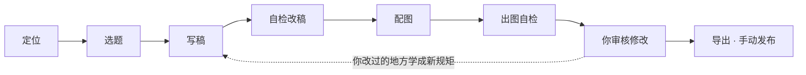

# 媒力 MediaFlow v2

**小红书 AI 运营助手。**你告诉它想做个什么样的号，它帮你定位、找选题、写稿、配图；你审一遍、改几笔，导出图文包自己发出去。

> v2 是完全重写的版本，专注「AI 把内容做好」这件事。默认本地运行、无需登录；也可以部署成**在线版**给几个人一起用（见 [DEPLOY.md](DEPLOY.md)）。旧版代码保留在 `main` 分支历史中。

## 产品概念

**给谁用**：想做小红书、但没时间天天写、不会做图的个人博主和小商家；同时运营好几个号的小团队。

### 一篇笔记是怎么来的



### 几个核心想法

1. **一个账号就是一个「博主」**：定位、写法规矩、选题库、配图模板、运营笔记、对话记忆都按账号单独存，写出来的每篇都像同一个人做的。
2. **先学会再动手**：可以先找一个已经做起来的对标账号，拆它的打法（人设、栏目、标题公式、开头、结构、封面），再换成你的主题来做，不凭空编，也不照抄原句。
3. **机器先把一道关**：写完先硬性检查、AI 评审，不合格自己重写；图出完自己看一遍，有错字、跑题就重出。你看到的是过了这几关的版本。
4. **对话就是操作台**：跟运营管家「小媒」说话就能改定位、记规矩、找选题、做调研、写稿、改稿改图；大部分按钮能做的事，说一句也能做。
5. **最后一步留给人**：只做到「导出图文包」，**不自动发布**；平台登录只用来搜内容、看数据（建议用小号），减少风控风险。

## 能做什么

### 建号和定位

- **多账号**：每个账号独立的定位、写作规矩、选题库、草稿、配图模板和对话记忆。
- **聊出定位**：和小媒聊几句，它把主题、受众、内容风格、配图风格整理好存进账号；之后随时说「以后别用 emoji」这类话，会记成长期规矩。
- **复刻对标账号**：给一个做起来的博主（主页链接 / 作品链接 / 名字），支持**小红书、抖音（只看图文作品）、微博**。自动读 TA 最近 60 条作品，细看互动最高的 5 篇正文和热评，拆出人设、内容栏目、标题公式、开头钩子、正文结构、封面风格和更新节奏，再换成你的主题：更新账号定位和写法规则，生成 8 个对应原爆款的复刻选题。不知道对标谁，可以按领域关键词搜博主，主要做视频的号会被筛掉。

### 找选题和做调研

- **选题搜索**：按账号定位的关键词去小红书 / 知乎 / 百度 / 抖音 / B站 / 微博 / 微信公众号文章搜真实内容（没配置的平台退回热榜），筛选后给出切入角度，和历史选题自动去重。
- **调研**：说「帮我分析一下博主 xx」「看看抖音上露营装备的爆款」，小媒会在小红书、抖音、B站、微博、公众号上搜博主、看作品、看详情，按「账号概况 → 内容结构 → 爆款规律 → 评论区 → 给你的建议」回复，要点存成**运营笔记**，之后写稿和出选题都会参考。拿不到的数据会标「无公开数据」，不编。

### 写稿

- **写稿流水线**：写稿 → 硬性检查（标题≤20 字、正文长度、标签数、敏感词、与旧稿重复度）+ AI 评审 → 不合格自动改写（最多 3 轮）→ 保存 → 后台配图。对话、选题页、自动模式三个入口共用同一条流水线。
- **照着爆款的结构写**：复刻选题会参考对应原爆款的结构和节奏，不照抄句子。
- **给编辑的说明单独放**：模型写给你的说明（比如「这里可以换成你的真实经历」）放在「给你的备注」里（只给你看），不混进要发的正文。

### 配图

- **账号配图模板**：学完对标账号后，看 TA 的爆款图，总结出「整体视觉 + 几种页型（封面 / 清单页 / 对比页…，各带样例图）」。之后每张图选一种页型照着排，整个账号风格统一；也可以贴几篇喜欢的笔记照着学，或跟小媒说「封面别放人」直接改。
- **配图不止 AI 画**，账号里选默认做法，每张图也能单独换：

  | 做法 | 说明 |
  | --- | --- |
  | AI 画整张 | 画面和字都由 AI 生成 |
  | AI 画画面 + 代码排字 | 字一定对，适合封面 |
  | 排版卡片 | 清单、步骤、对比、金句，8 种配色，不用生图额度 |
  | 网上找图 + 代码排字 | 从 360 图片 / 必应找真实照片，标出处；找不到合适的自动改成排版卡片 |
  | 自动 | 每张按内容挑：字多的做卡片，封面 AI 画，要真实感的找图 |

  代码排的字可以直接改，当场重排、不重新出图。没有 AI 生图 Key 时，「排版卡片」和「网上找图」照样能出图。网上找的图发之前请自己确认版权。
- **出图后自检**：每张图出完让 AI 看一眼（错字乱码、画面和描述对不对、和同套是不是一个风格），有问题自动带着修改意见重出一次；可在「AI 配图」设置里关掉。

### 改稿、审核和发布

- **对话改稿改图**：草稿页点「让小媒改」，直接说「第 2 张换成对比图」「再加一张清单图」「开头改得更抓人」；配图卡片上也能改描述、改字、换做法、加一张、删一张、调顺序。
- **导出**：一键复制文案，或下载包含文案和图片的 zip，自己发布。

### 越用越懂你

- **从修改里学**：你改过的稿子和反馈，可以让 AI 总结成新规矩，确认后生效。
- **长对话不失忆**：最近十几轮对话原样带着，更早的自动整理成要点（你的情况、偏好、做过的决定）长期保留，聊久了不会忘事，也不会越聊越慢。

### 自动化和多人使用

- **自动模式**：按每天 / 每 2 天 / 每周自动写一篇放进「待审核」，先写复刻选题，写完再按打法找新选题；**不会自动发布**。
- **在线版**：演示版（免登录、设置锁定、全站额度）或登录版（管理员开账号、数据按人隔离、每人每日额度）。
- **模型可选**：写稿聊天用 DeepSeek，或 openai-next（在「模型」里填），出错自动换另一个。

### 暂时不做

- 不自动发布，不刷量，不用你的平台账号发帖、评论。
- 只做图文笔记，不做视频。
- 知乎、B站、公众号的博主暂时不能当对标（拿不到可复刻的图文作品），但可以用来找选题和调研。

## 快速开始

需要 Python 3.11+、[uv](https://docs.astral.sh/uv/)、Node 20+。

```bash
# 1. 构建前端（只需一次，改了前端再跑）
cd web && npm install && npm run build && cd ..

# 2. 配置并启动
cd server
cp .env.example .env        # 可选：DeepSeek Key 也可以打开页面后在首页「开始之前」里填
uv run mediaflow            # 自动打开 http://127.0.0.1:8765
```

数据（SQLite 数据库和图片）默认存放在 `server/data/`，备份这个目录即可。

### 配置项

| 变量 | 必填 | 说明 |
| --- | --- | --- |
| `DEEPSEEK_API_KEY` | 二选一 | 写稿、评审、对话都用 DeepSeek；也可以在页面里填（填的时候会先验证能不能用） |
| `IMAGE_NEXT_API_KEY` | 二选一 | openai-next 的 Key：AI 配图优先用它（额度用完或出不了图自动换 grsai）；**同一个 Key 也能调 DeepSeek 写稿聊天**（默认模型 `deepseek-v4-1-flash-261017`，`LLM_NEXT_MODEL` 可改），配了就优先走它，出错自动换 DeepSeek 官方；只填它不填 `DEEPSEEK_API_KEY` 也能用（看图也走它） |
| `IMAGE_API_KEY` | 否 | AI 配图（grsai，备用）；两个都不填时，配图做法选「排版卡片」或「网上找图」照样能出图，选「AI 画」就只生成文案。两个 Key 也都能在「AI 配图」设置里填 |
| `DEEPSEEK_VISION_MODEL` | 否 | 看图用的模型（学配图模板、出图自检），默认 `deepseek-flash`，同一个 DeepSeek Key；留空就不看图 |
| `MEDIAFLOW_DATA_DIR` | 否 | 数据目录，默认 `server/data` |
| `MEDIAFLOW_PORT` | 否 | 端口，默认 8765 |

完整列表见 `server/.env.example`。

### 在线版（部署到服务器）

`MEDIAFLOW_AUTH` 决定模式，部署步骤（Docker 或 systemd + nginx、国内镜像源、HTTPS、备案、备份）见 **[DEPLOY.md](DEPLOY.md)**：

| 模式 | 适合 | 说明 |
| --- | --- | --- |
| `demo` 演示版 | 演示、小范围试用 | 打开就能用，大家共用一份数据；设置锁住，管理员在 `/admin` 输 `MEDIAFLOW_ADMIN_TOKEN` 后才能改；`MEDIAFLOW_DAILY_WRITES` / `MEDIAFLOW_DAILY_CHATS` 是全站每天总额度 |
| `password` 登录版 | 正式多人使用 | 管理员开账号，数据按人隔离，每人每日额度；需要 `MEDIAFLOW_SECRET`、`MEDIAFLOW_ADMIN_USER` / `MEDIAFLOW_ADMIN_PASSWORD`；忘了密码 `mediaflow reset-password <用户名>` |
| 不设 | 自己电脑上用 | 本地版，别直接暴露到公网 |

### 数据来源（选题搜索）

在「账号」页右上角或选题面板点 **数据来源** 配置，保存在 `data/credentials.json`（优先于 `.env` 里的同名变量），可一键测试。

| 平台 | 配置 | 不配置时 |
| --- | --- | --- |
| 小红书 | 应用内 **扫码登录**（建议用小号）；也可手填 Cookie（`XHS_COOKIE`），签名用 [xhshow](https://github.com/Cloxl/xhshow) | 关闭 |
| 知乎 | [知乎开放平台](https://developer.zhihu.com/) Access Secret（`ZHIHU_ACCESS_SECRET`） | 关闭 |
| 百度 | [百度千帆](https://console.bce.baidu.com/qianfan/) API Key，用于 AI 搜索（`QIANFAN_API_KEY`） | 百度热搜榜 |
| 抖音 | 浏览器登录抖音后复制的 Cookie（`DOUYIN_COOKIE`），签名用 a_bogus | 抖音热榜 |
| B站 | 应用内 **扫码登录**，之后每天自动检查并续期 Cookie；也可手填（`BILIBILI_COOKIE`） | 游客身份搜索 |
| 微博 | 浏览器登录微博后复制的 Cookie（`WEIBO_COOKIE`） | 微博热搜榜 |
| 微信文章 | 无需配置（搜狗微信搜索，太频繁会要求验证码） | — |

Cookie 获取：浏览器登录对应网站 → F12 → 网络 → 任一请求的请求头 `Cookie` 整段复制。抖音偶尔会触发风控，重新在浏览器里搜一次再复制 Cookie 即可。

### 调研（让小媒分析博主 / 爆款）

在对话里直接说「帮我分析一下小红书博主程十安」「看看抖音上露营装备的爆款」，小媒会调用调研工具查真实数据，
按「账号概况 → 内容结构 → 爆款规律 → 评论区 → 给你的建议」回复，并把要点存成**运营笔记**（配置页可查看/删除），之后写稿和出选题会参考。

| 平台 | 搜内容 | 搜博主 | 看博主作品 | 看作品详情 | 需要 |
| --- | --- | --- | --- | --- | --- |
| 小红书 | ✅ | ✅ | ✅ 点赞 | ✅ 正文/标签/收藏/热评 | 登录 |
| 抖音 | ✅ | ✅ | ✅ 点赞/评论/收藏/分享 | ✅ 话题/热评 | Cookie |
| B站 | ✅ | ✅ | ✅ 播放/评论 | ✅ 简介/标签/收藏/热评 | 游客即可 |
| 微博 | ✅ | ✅ | ✅ 转评赞 | ✅ 长文/话题/热评 | Cookie |
| 微信公众号 | ✅ | ⚠️ 按文章来源聚合，无粉丝数 | ⚠️ 仅搜狗收录的部分，无阅读数 | ✅ 正文 | — |
| 知乎 / 百度 | ✅ | — | — | — | 见上表 |

同一平台的调研请求串行、间隔 ≥1.5 秒，相同请求 10 分钟内走缓存，降低风控概率。设计说明见 `docs/agent-architecture.md`。

### 复刻对标账号

两个入口：首页「复刻一个账号」（新建账号时一起拆），或工作台「对标」页；也可以直接跟小媒说「照这个号的路子做职场理财」并贴链接。
不知道对标谁，可以在「对标」页选平台（小红书 / 抖音 / 微博）、按领域关键词搜博主（按粉丝排序）。

| 平台 | 能对标 | 需要 |
| --- | --- | --- |
| 小红书 | ✅ | 扫码登录 |
| 抖音 | ✅ 只拆图文作品（主要做视频的号会提醒并只看图文） | Cookie |
| 微博 | ✅ | Cookie |
| 知乎 / B站 / 公众号 | ❌ 拿不到可复刻的图文作品 | — |

流程（后台任务，约 1-2 分钟）：找到博主 → 读最近 60 条作品、算更新频率 / 点赞中位数 / 爆款率 → 细看互动最高的 5 篇 →
拆打法 → 按你的主题出方案 → 同步到账号（定位、写法规则、复刻选题）→ 看 TA 的爆款图学配图模板。之后「立即创作」和自动模式会先按顺序写复刻选题，写完再按打法找新选题。
重新拆解或换一个对标时，上一次生成的写法规则会停用、没用过的复刻选题会收起。

## 开发

```bash
# 后端（热重载）
cd server && uv run mediaflow --reload --no-browser
# 前端（5173 端口，接口代理到 8765）
cd web && npm run dev
# 测试
cd server && uv run pytest
# 改了接口后重新生成前端类型（后端需在运行）
cd web && npm run gen:api
```

目录结构和约定见 [AGENTS.md](AGENTS.md)。

## 路线图

- [x] 第一阶段：多账号、对话配置定位、热点选题、写稿自检、AI 配图、导出
- [ ] 发布前预览更接近小红书真实效果
- [ ] 数据回流：导入笔记数据，反哺选题和写法
- [ ] 稳定的自动发布（视平台情况）
- [x] 在线版：演示版（免登录、设置锁定、全站额度）/ 登录版（成员管理、数据隔离、每人额度）
- [ ] 成员自己连平台账号、按人计费
