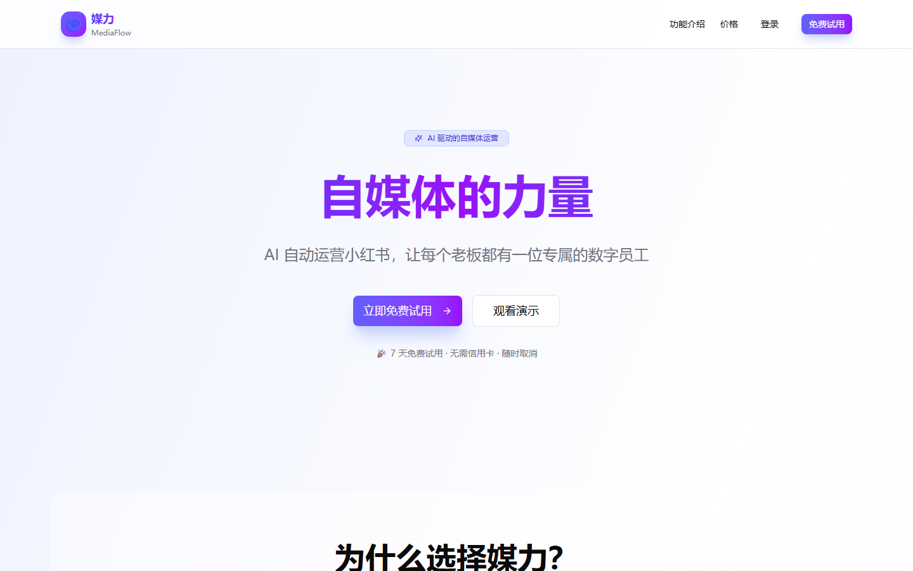
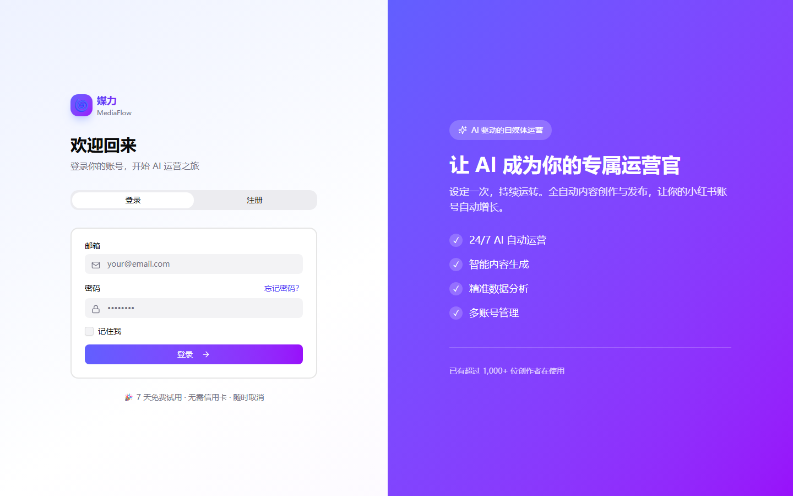
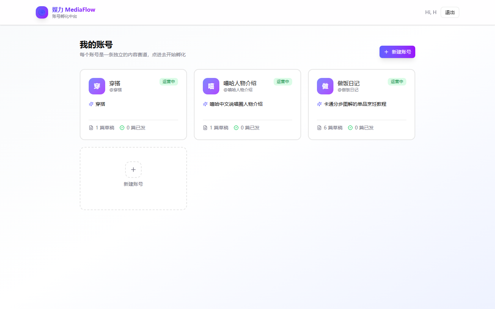
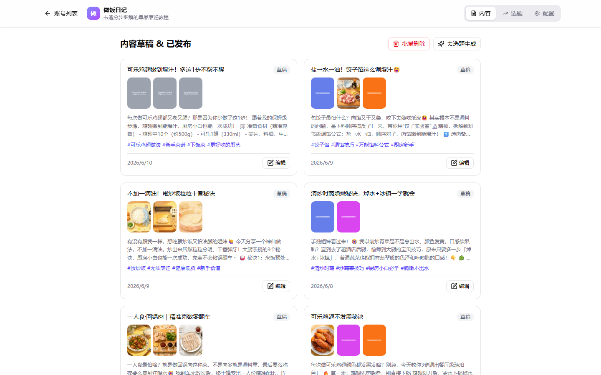
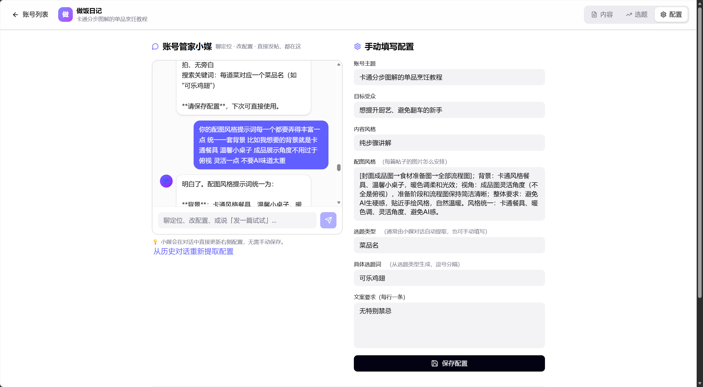
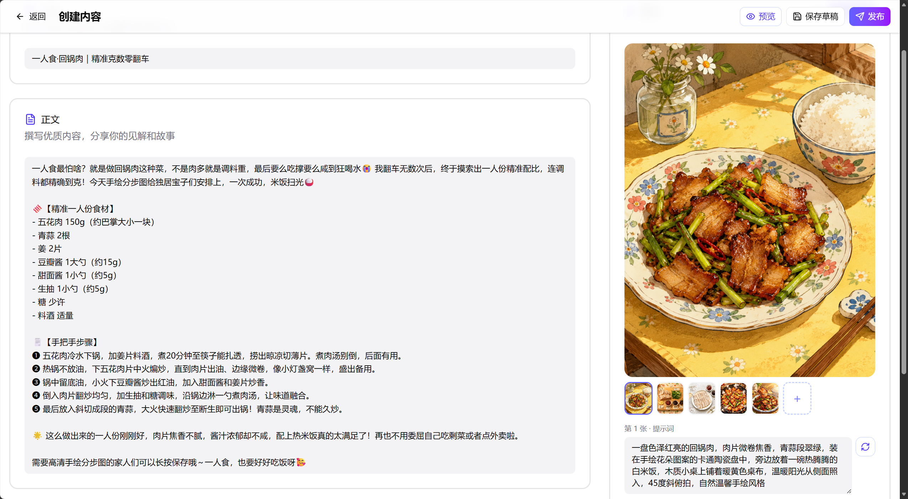
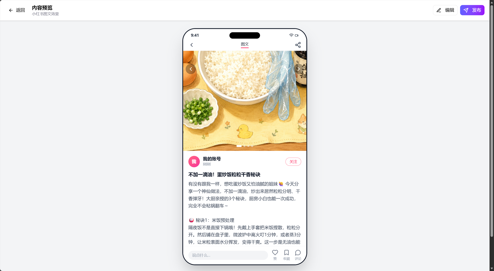
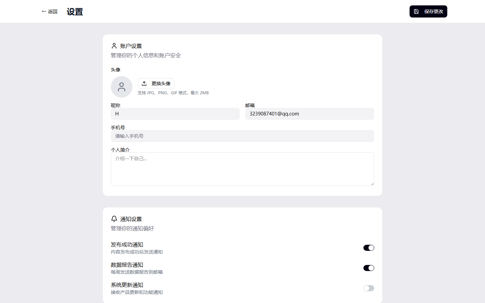

# MediaFlow（媒力）

AI 驱动的小红书内容运营平台。核心是「小媒」AI 运营官——通过对话了解你的内容偏好，自动生成图文内容，并发布到小红书账号；同时提供「龙虾」AI 员工系统，可配置自动化运营任务（选题搜索、自动生成、自动发布）。

## 功能特色

- 💬 **AI 对话式配置**：与「小媒」自然语言对话，AI 自动分析并提取内容偏好（风格、受众、发布频率等）
- ✍️ **AI 内容生成**：基于 DeepSeek 大模型生成小红书图文文案（标题、正文、标签）
- 🖼️ **AI 配图**：可选接入 OpenAI 图片生成（gpt-image-2 等），未配置时使用占位图
- 🦞 **龙虾 AI 员工系统**：创建多个 AI 员工，分别绑定不同账号与偏好，自动化选题、生成、发布
- 🔍 **热点选题搜索**：支持微博热搜、抖音热点等渠道获取选题素材
- 👥 **多账号管理**：通过 xiaohongshu-mcp 多账号管理服务，绑定/切换多个小红书账号
- 📤 **一键发布**：草稿管理 + 预览 + 发布到小红书
- 📧 **邮箱注册/找回密码**：基于 SMTP（QQ 邮箱 / Gmail）的验证码服务
- ⏰ **定时调度**：基于 APScheduler 的自动运营任务调度

## 功能截图

| 首页 | 登录 |
|------|------|
|  |  |

| 我的账号（账号孵化中台） | 账号工作台（草稿/已发布） |
|------|------|
|  |  |

| 与「小媒」AI 对话 | 创建内容 |
|------|------|
|  |  |

| 内容预览（小红书效果） | 设置 |
|------|------|
|  |  |

## 技术栈

| 模块 | 技术 |
|------|------|
| 后端 | Python 3 + FastAPI + SQLAlchemy（SQLite，可切换 PostgreSQL）+ JWT 认证 + APScheduler |
| 前端 | React 18 + Vite + TypeScript + Tailwind CSS v4 + shadcn/ui (Radix UI) + react-router v7 |
| AI 文本 | DeepSeek API（chat/completions） |
| AI 配图 | OpenAI 图片生成 API（可选） |
| 内容发布 | xiaohongshu-mcp（本地小红书自动化服务，含多账号管理） |
| 测试 | pytest（后端）/ vitest + Playwright（前端） |

## 目录结构

```
mediaflow/
├── backend/                  # FastAPI 后端
│   ├── main.py               # 入口，端口 8000
│   ├── models.py             # SQLAlchemy 数据模型
│   ├── database.py           # 数据库初始化
│   ├── dependencies.py       # JWT / 认证 / 公共依赖
│   ├── scheduler.py           # 自动运营任务调度器
│   ├── routers/               # API 路由（auth/users/chat/contents/publish/...）
│   ├── services/              # 业务服务
│   │   ├── ai_service.py          # DeepSeek 内容生成
│   │   ├── image_service.py       # AI 配图
│   │   ├── email_service.py       # SMTP 邮件服务
│   │   ├── xiaohongshu_mcp.py      # 小红书 MCP 客户端
│   │   ├── multi_account_client.py # 多账号管理客户端
│   │   ├── topic_search.py         # 选题搜索（微博/抖音）
│   │   ├── auto_agent.py           # 自动运营逻辑
│   │   └── agent/                  # AI 员工（龙虾）核心逻辑
│   ├── tests/                 # 后端测试
│   └── uploads/               # 上传文件目录
├── frontend/                  # React 前端
│   └── src/app/
│       ├── pages/              # 页面（auth/chat/contents/create/preview/settings/...）
│       └── components/         # 通用组件 / shadcn-ui 组件
├── xiaohongshu-mcp/            # 小红书自动化 MCP 服务（独立子项目）
├── scripts/                    # 启停脚本
├── docs/                       # 项目文档（API 参考、部署、PRD 等）
├── start.bat / stop.bat        # 一键启停（Windows）
└── AGENTS.md                   # AI 协作开发说明
```

## 环境要求

- Python 3.10+
- Node.js 18+
- （可选）xiaohongshu-mcp 服务，用于发布到小红书与多账号管理

## 快速开始

### 1. 配置环境变量

```bash
cd backend
copy .env.example .env
```

然后编辑 `.env`，至少配置以下必填项：

- `DEEPSEEK_API_KEY`：DeepSeek API Key（内容生成必需）
- `SMTP_USER` / `SMTP_PASSWORD`：邮箱账号与授权码（注册验证码必需）
- `SECRET_KEY`：JWT 签名密钥（生产环境务必修改）

其余可选项（图片生成、微博/抖音 Cookie、小红书 MCP 地址、支付配置等）详见 `backend/.env.example` 中的注释说明。

### 2. 启动后端

```bash
cd backend
pip install -r requirements.txt
python main.py
```

后端默认运行在 `http://localhost:8000`，启动后会自动初始化 SQLite 数据库（`mediaflow.db`），健康检查接口为 `GET /health`。

### 3. 启动前端

```bash
cd frontend
npm install
npm run dev
```

前端默认运行在 Vite 开发端口（默认 `5173`），构建生产包使用 `npm run build`。

### 4. 一键启停（Windows）

项目根目录提供了 `start.bat` / `stop.bat`，封装了 `scripts/services.py`，可同时启动/停止前后端服务。

```bash
start.bat
stop.bat
```

### 5.（可选）启动小红书 MCP 服务

如需发布内容到小红书或使用多账号功能，需要额外运行 `xiaohongshu-mcp` 服务（默认监听 `18060`，多账号管理默认 `8080`），并在 `.env` 中配置：

```
XIAOHONGSHU_MCP_URL=http://localhost:18060
MULTI_ACCOUNT_MANAGER_URL=http://localhost:8080
```

未启动该服务时，账号管理与发布相关接口会优雅降级（返回部分数据或提示未连接）。

## 核心数据模型

- **User**：用户账号（邮箱/手机号 + 密码）
- **Subscription**：订阅计划（trial/basic/pro/enterprise）
- **Lobster**：AI 员工（绑定用户，含独立偏好设置）
- **UserPreference**：用户偏好（内容要求、图片来源、发布频率、目标平台）
- **ConversationHistory**：与「小媒」的聊天记录
- **Content**：内容草稿（标题/正文/标签/配图）
- **PublishTask**：发布任务及状态追踪
- **XiaohongshuAccountBinding**：小红书账号绑定（多账号映射）

## 核心流程

1. 用户注册 → 系统自动创建默认 AI 员工「阿龙」+ 7 天试用订阅
2. 在「小媒」聊天页与 AI 对话 → AI 分析需求并保存为用户偏好
3. 在创建页生成内容 → AI 撰写文案（可选 AI 配图）→ 保存为草稿
4. 在内容管理页预览/编辑草稿 → 通过 MCP 服务发布到小红书
5. （可选）配置 AI 员工自动运营：调度器按设定频率自动选题、生成、发布

## API 概览

后端按业务划分为多个路由模块（统一前缀 `/api`，详见 `backend/routers/`）：

| 路由 | 说明 |
|------|------|
| `auth` | 注册 / 登录 / 邮箱验证码 / 找回密码 |
| `users` | 用户资料、偏好设置、数据导出 |
| `lobsters` | AI 员工（龙虾）管理 |
| `chat` | 与「小媒」的 AI 对话与需求分析 |
| `contents` | 内容草稿的增删改查与生成 |
| `publish` | 发布任务管理 |
| `config` | 系统配置 |
| `upload` | 文件上传 |
| `xiaohongshu_accounts` | 小红书账号绑定与多账号管理 |
| `agent` | AI 员工自动运营任务 |
| `accounts_workspace` | 账号工作台 |

详细接口文档见 `docs/API-REFERENCE.md`。

## 测试

```bash
# 后端
cd backend
pytest

# 前端
cd frontend
npm run test
```

## 已知注意事项

- `SECRET_KEY` 默认值为占位字符串，生产部署前必须修改为随机值
- QQ 邮箱发件需使用纯邮箱格式作为 From 头（详见 `backend/services/email_service.py`）
- 小红书发布、多账号管理依赖本地 `xiaohongshu-mcp` 服务，未启动时相关功能会降级
- 微博/抖音热点搜索为可选功能，未配置 Cookie 时会降级为热搜榜

## 相关文档

- `AGENTS.md`：面向 AI 协作开发的项目说明（架构、约定、扩展模式）
- `docs/API-REFERENCE.md`：API 接口文档
- `docs/DEPLOY.md`：部署说明
- `docs/PRD-v1.0.md` / `docs/PRD-v1.1.md`：产品需求文档
- `Docker_Install_Guide.md`：Docker 安装指南
